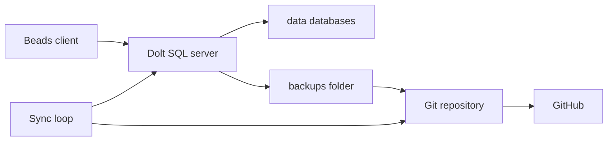

# Beads Dolt

Dolt server that stores one Beads database per project and pushes changes to GitHub.

Fork this repository for your own server and keep that fork private. Once the server is running, its git history contains an SQL dump of every database. This repository does not.

It runs in Docker and checks for changes every six hours.

## 📑 Contents

- [Requirements](#-requirements)
- [Installation](#-installation)
- [Databases](#-databases)
- [Usage](#-usage)
- [Configuration](#-configuration)
- [Architecture](#-architecture)
- [License](#-license)

## 📦 Requirements

- [Docker](https://docs.docker.com/get-started/get-docker/) with the `docker compose` command
- [Git](https://git-scm.com/downloads)
- [GNU Make](https://www.gnu.org/software/make/)
- [Beads](https://github.com/gastownhall/beads/blob/main/docs/getting-started/installation.md) (`bd`)
- A [GitHub SSH key](https://docs.github.com/en/authentication/connecting-to-github-with-ssh) that can push to your fork

## 🔧 Installation

1. Fork this repository and clone your fork.

```bash
git clone git@github.com:<you>/beads-dolt.git
cd beads-dolt
```

2. Put the SSH private key in `.ssh`. [`docker-compose.yml`](docker-compose.yml) mounts that directory into the container, and the sync push uses it.

3. Start the server.

```bash
make start
```

4. Load the databases from `backups/`. A new fork has none yet, and a database the server already serves is left as it is.

```bash
make restore
```

5. Check that the server is up.

```bash
make test
```

This runs inside the container. A running server prints `✅ Dolt is serving on port 3307`. `make databases` lists what it is serving.

6. Connect each project by following [Switch an existing project](#switch-an-existing-project). One project uses one database.

## 📚 Databases

[`bin/sync.sh`](bin/sync.sh) rewrites the table between the markers from the databases this server is serving. A repository is filled in from the first value it finds: `sync.remote`, `github.repo`, `gitlab.repo`, a Dolt remote named `origin`, a route, or a repo path. Edit the text outside the markers. The next sync replaces the table.

<!-- databases:start -->
| Database | Issue prefix | Repository |
| --- | --- | --- |
<!-- databases:end -->

## 💻 Usage

| Command | Description |
|---------|-------------|
| `make start` | Start the server in the background |
| `make test` | Check that the server is accepting connections |
| `make stop` | Stop and remove the container |
| `make build` | Build the Docker image |
| `make rebuild` | Build from scratch (no cache) |
| `make restart` | Stop then start |
| `make shell` | Open a bash shell in the container |
| `make mysql` | Connect to the dolt server via mysql |
| `make logs` | Tail the sync log |
| `make databases` | List each database, its issue prefix, and its repository URL when one is stored |
| `make issues` | List issues in every database |
| `make issues DB=<database>` | List issues in one database |
| `make stats` | Print a table of issue counts for every database, by status, priority, and total |
| `make purge DB=<database>` | Drop one database after you type its name |
| `make db-rename` | Ask which database to rename, the new name, and an optional repository. Confirmation defaults to no |
| `make restore` | Load every database in `backups/` that the server is not serving |
| `make restore DB=<database>` | Load one database from `backups/<database>.sql` |

The targets are defined in the [`Makefile`](Makefile). [`bin/databases.sh`](bin/databases.sh) is the script behind these targets. An issue line looks like `pl-dcq [CLOSED][P2](feature): Implement Admin Worker Tasks page (pl-ri6)`. `make issues` prefixes each line with its database, as in `beads_pl/pl-dcq [CLOSED][P2](feature): Implement Admin Worker Tasks page (pl-ri6)`. `make issues DB=<database>` prints the id alone. In a terminal the id is cyan, the status is colored by state, and the type is magenta. `./bin/databases.sh issues --no-color` prints the same text in plain form, and so does a set `NO_COLOR` variable. An unknown database name prints `Database <database> was not found. Available options:` followed by that list. `make db-rename` asks which database, the new name, and an optional repository. Pressing Enter at the confirmation leaves the database unchanged. Answering `y` stops the server, renames that database's directory under `data/` and its backup under `backups/`, and starts the server. Dolt keeps the issue prefix. A repository you type is stored as `sync.remote`. `make purge` drops a single database, and only after the name you type matches it. `information_schema`, `mysql`, `performance_schema`, and `sys` are refused. It also removes that database's backup under `backups/` and Dolt's copy under `data/.dolt_dropped_databases/`, so the next sync does not commit the dropped database.

| Command | Description |
| --- | --- |
| `bd dolt show` | Print the mode and connection. Embedded mode prints `Mode: embedded` |
| `bd dolt commit` | Commit pending Beads changes |
| `bd dolt push` | Push the project's database to its Dolt remote |
| `bd dolt pull` | Pull the project's database from its Dolt remote |

`bd dolt set` and `bd dolt test` run after the project has left embedded mode. Until then they exit with `not supported in embedded mode (no Dolt server)`.

### Switch an existing project

Run this in the project directory.

```bash
# Save the issues. The next section deletes the embedded database.
bd export --all -o .beads/issues.jsonl
git add .beads/issues.jsonl
git commit -m "backup beads issues before moving to the dolt server"

# Project names. Use host.docker.internal for SERVER_HOST from another container.
PREFIX=$(bd config get issue_prefix)
DB_PREFIX=beads_
DATABASE="${DB_PREFIX}${PREFIX}"
SERVER_HOST=127.0.0.1
SERVER_PORT=3307

# Move the project onto this server.
bd init --reinit-local --server --external \
  --server-host "$SERVER_HOST" \
  --server-port "$SERVER_PORT" \
  --server-user root \
  --database "$DATABASE" \
  --prefix "$PREFIX" \
  --skip-agents \
  --non-interactive \
  --destroy-token="DESTROY-${PREFIX}"

# Load the saved issues.
bd import .beads/issues.jsonl
bd dolt show

# Keep .beads/issues.jsonl updating in the project.
bd config set export.auto true
bd config set export.git-add true
```

### Restore a database

Each sync writes an SQL dump of every database to `backups/<database>.sql`, one row per line, and git commits only the rows that changed. Restore loads a dump into the running server, so no restart is needed. It restores the data, not the Dolt commit history.

```bash
make restore DB=<database>
```

`<database>` is a file name under `backups/` without `.sql`, such as `beads_pl`. A database the server already serves is refused with `Database <database> is already served. Not restored.` Drop it first with `make purge DB=<database>` only if the backup should replace it, because purge also deletes `backups/<database>.sql`. Copy that file out of the way before the purge. A name with no backup prints `No backup for <database> under backups/.`

## 🔩 Configuration

| Variable | Required | Default | Description |
| --- | --- | --- | --- |
| `SYNC_INTERVAL` | No | `21600` | Seconds between sync cycles. Six hours. Set it in the environment before `make start`. [`docker-compose.yml`](docker-compose.yml) passes it to [`bin/entrypoint.sh`](bin/entrypoint.sh). |
| `BACKUP_KEEP` | No | `50` | Auto-sync commits kept in git history. Older ones are folded away, and their dumps survive only in the commit after them. Set it in the environment before `make start`, like `SYNC_INTERVAL`. |

```bash
SYNC_INTERVAL=300 make start
```

`SYNC_SCHEDULE` is ignored.

The server listens on port `3307`. To change it, edit the port in [`docker-compose.yml`](docker-compose.yml), [`bin/entrypoint.sh`](bin/entrypoint.sh), and [`bin/sync.sh`](bin/sync.sh).

On startup the server writes `data/config.yaml`. That file holds logging, TLS, and the other [Dolt server configuration](https://docs.dolthub.com/sql-reference/server/configuration) options.

The commit author is `dev <dev@dolt.local>`. Change the `dolt config` lines in the [`Dockerfile`](Dockerfile) and rebuild.

From another container, Docker already resolves `host.docker.internal` to this machine:

```bash
bd dolt set host host.docker.internal
bd dolt set port 3307
bd dolt set user root
bd dolt set database <database>
```

Add a Dolt remote through the running server. `<remote-url>` is an address such as `https://doltremoteapi.dolthub.com/<org>/<database>` or `ssh://git@github.com:<org>/<database>.git`.

```sql
USE <database>;
CALL dolt_remote('add', 'origin', '<remote-url>');
SELECT * FROM dolt_remotes;
```

The sync cycle does not pull or push Dolt remotes. Use `bd dolt push` and `bd dolt pull` from the project.

| Host | Container | Purpose |
| --- | --- | --- |
| `./data` | `/data` | Live databases, not committed, and server config |
| `.` | `/repo` | Git repository, including the committed backups in `backups/` |
| `.ssh` | `/home/dev/.ssh` | SSH key used for the Git push |
| [`bin/entrypoint.sh`](bin/entrypoint.sh) | `/usr/local/bin/entrypoint.sh` | Process entrypoint |
| [`bin/sync.sh`](bin/sync.sh) | `/usr/local/bin/sync.sh` | Sync script |

## 🧱 Architecture



[`bin/entrypoint.sh`](bin/entrypoint.sh) starts the SQL server on port 3307 and serves each database directory under `data/`. [`bin/sync.sh`](bin/sync.sh) runs on startup and then every `SYNC_INTERVAL` seconds. For each database it makes a Dolt commit, writes the SQL dump to `backups/<database>.sql`, and runs garbage collection. Then it commits a dirty git tree and pushes when `main` is ahead of `origin/main`. Once there are more than `BACKUP_KEEP` auto-sync commits, the oldest ones are folded into the commit after them and `main` is force-pushed. Your own commits are kept.

## 📄 License

[MIT](LICENSE)
