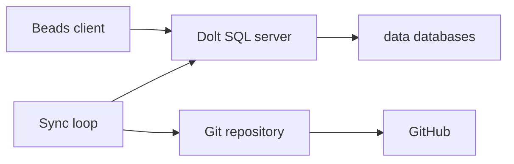

# Beads Dolt

Dolt server that stores one Beads database per project and pushes changes to GitHub.

Fork this repository for your own server and keep that fork private. Once the server is running, its git history contains the database files. This repository does not.

It runs in Docker and checks for changes every minute.

## 📑 Contents

- [Requirements](#-requirements)
- [Installation](#-installation)
- [Databases](#-databases)
- [Usage](#-usage)
- [Configuration](#-configuration)
- [Architecture](#-architecture)
- [Troubleshooting](#-troubleshooting)
- [License](#-license)

## 📦 Requirements

- [Docker](https://docs.docker.com/get-started/get-docker/) with the `docker compose` command
- [Git](https://git-scm.com/downloads)
- [GNU Make](https://www.gnu.org/software/make/)
- [Beads](https://github.com/gastownhall/beads/blob/main/docs/getting-started/installation.md) (`bd`)
- A [GitHub SSH key](https://docs.github.com/en/authentication/connecting-to-github-with-ssh) that can push to your fork

## 🔧 Installation

1. Fork this repository and clone your fork.

```bash
git clone git@github.com:<you>/beads-dolt.git
cd beads-dolt
```

2. Put the SSH private key in `.ssh`. [`docker-compose.yml`](docker-compose.yml) mounts that directory into the container, and the sync push uses it.

3. Start the server.

```bash
make start
```

4. Check that the server is up.

```bash
make test
```

This runs inside the container. A running server prints `✅ Dolt is serving on port 3307`. `make databases` lists what it is serving.

5. Connect each project by following [Switch an existing project](#switch-an-existing-project). One project uses one database.

## 📚 Databases

[`bin/sync.sh`](bin/sync.sh) rewrites the table between the markers from the databases this server is serving. A repository is filled in from the first value it finds: `sync.remote`, `github.repo`, `gitlab.repo`, a Dolt remote named `origin`, a route, or a repo path. Edit the text outside the markers. The next sync replaces the table.

<!-- databases:start -->
| Database | Issue prefix | Repository |
| --- | --- | --- |
<!-- databases:end -->

## 💻 Usage

| Command | Description |
|---------|-------------|
| `make start` | Start the server in the background |
| `make test` | Check that the server is accepting connections |
| `make stop` | Stop and remove the container |
| `make build` | Build the Docker image |
| `make rebuild` | Build from scratch (no cache) |
| `make restart` | Stop then start |
| `make shell` | Open a bash shell in the container |
| `make mysql` | Connect to the dolt server via mysql |
| `make logs` | Tail the sync log |
| `make databases` | List each database, its issue prefix, and its repository URL when one is stored |
| `make issues` | List issues in every database |
| `make issues DB=<database>` | List issues in one database |
| `make stats` | Print a table of issue counts for every database, by status, priority, and total |
| `make purge DB=<database>` | Drop one database after you type its name |
| `make db-rename FROM=<old> TO=<new>` | Rename one database after you type the new name |

The targets are defined in the [`Makefile`](Makefile). [`bin/databases.sh`](bin/databases.sh) is the script behind these targets. An issue line looks like `pl-dcq [CLOSED][P2](feature): Implement Admin Worker Tasks page (pl-ri6)`. `make issues` prefixes each line with its database, as in `beads_pl/pl-dcq [CLOSED][P2](feature): Implement Admin Worker Tasks page (pl-ri6)`. `make issues DB=<database>` prints the id alone. In a terminal the id is cyan, the status is colored by state, and the type is magenta. `./bin/databases.sh issues --no-color` prints the same text in plain form, and so does a set `NO_COLOR` variable. An unknown database name prints `Database <database> was not found. Available options:` followed by that list. `make db-rename FROM=<old> TO=<new>` stops the server, renames that database's directory under `data/`, and starts the server. Dolt keeps the issue prefix. Type the new name when asked. `make purge` drops a single database, and only after the name you type matches it. `information_schema`, `mysql`, `performance_schema`, and `sys` are refused. It also removes that database's copy under `data/.dolt_dropped_databases/`, so the next sync does not commit the dropped database.

| Command | Description |
| --- | --- |
| `bd dolt show` | Print the mode and connection. Embedded mode prints `Mode: embedded` |
| `bd dolt commit` | Commit pending Beads changes |
| `bd dolt push` | Push the project's database to its Dolt remote |
| `bd dolt pull` | Pull the project's database from its Dolt remote |

`bd dolt set` and `bd dolt test` run after the project has left embedded mode. Until then they exit with `not supported in embedded mode (no Dolt server)`.

### Switch an existing project

Beads starts a project in embedded mode. The database is `.beads/embeddeddolt/`. `bd dolt show` prints `Mode: embedded`. `bd dolt set` and `bd dolt test` exit with `not supported in embedded mode (no Dolt server)`. Writing `dolt.mode` in `.beads/config.yaml` leaves the project embedded.

Leave embedded mode with `bd init --server --external`, after the export below. `bd export` writes the issue records, including labels, dependencies, and comments. It does not include Dolt branch history. The embedded database stays in `.beads/embeddeddolt/`.

1. In the project, write the export and commit `.beads/issues.jsonl` there.

```bash
bd export --all -o .beads/issues.jsonl
git add .beads/issues.jsonl
git commit -m "backup beads issues before moving to the dolt server"
```

2. Read the current issue prefix.

```bash
bd config get issue_prefix
```

3. Connect the project to a new database. `<database>` must be a name that is not already in [Databases](#-databases). `<prefix>` is the value printed above. From another container, use `--server-host host.docker.internal`.

```bash
bd init --server --external --server-host 127.0.0.1 --server-port 3307 --server-user root --database <database> --prefix <prefix> --skip-agents
```

`bd init` records server mode in `.beads/metadata.json` and creates `<database>` on this server when it is missing. It can also commit beads files in the project. `bd dolt show` then prints `Mode: server`, and `bd dolt set` works. Until the import below, `bd list` reads the new database and shows no issues.

4. Load the export. `<issue-id>` is an id from `.beads/issues.jsonl`.

```bash
bd import .beads/issues.jsonl
bd show <issue-id>
```

5. Keep `.beads/issues.jsonl` in the project repository.

```bash
bd config set export.auto true
bd config set export.git-add true
```

`export.auto` rewrites `.beads/issues.jsonl` after later `bd` writes. `export.git-add` stages that file. Both settings are stored in `.beads/config.yaml`. Commit `.beads/issues.jsonl` in the project when it changes, and keep that file tracked.

## 🔩 Configuration

| Variable | Required | Default | Description |
| --- | --- | --- | --- |
| `SYNC_INTERVAL` | No | `60` | Seconds between sync cycles. Set it in the environment before `make start`. [`docker-compose.yml`](docker-compose.yml) passes it to [`bin/entrypoint.sh`](bin/entrypoint.sh). |

```bash
SYNC_INTERVAL=300 make start
```

`SYNC_SCHEDULE` is ignored.

The server listens on port `3307`. To change it, edit the port in [`docker-compose.yml`](docker-compose.yml), [`bin/entrypoint.sh`](bin/entrypoint.sh), and [`bin/sync.sh`](bin/sync.sh).

On startup the server writes `data/config.yaml`. That file holds logging, TLS, and the other [Dolt server configuration](https://docs.dolthub.com/sql-reference/server/configuration) options.

The commit author is `dev <dev@dolt.local>`. Change the `dolt config` lines in the [`Dockerfile`](Dockerfile) and rebuild.

From another container, a project that has left embedded mode reaches this server at `host.docker.internal`. Add the name on the host when it is missing:

```bash
echo "127.0.0.1 host.docker.internal" | sudo tee -a /etc/hosts
```

```bash
bd dolt set host host.docker.internal
bd dolt set port 3307
bd dolt set user root
bd dolt set database <database>
```

Add a Dolt remote through the running server. `<remote-url>` is an address such as `https://doltremoteapi.dolthub.com/<org>/<database>` or `ssh://git@github.com:<org>/<database>.git`.

```sql
USE <database>;
CALL dolt_remote('add', 'origin', '<remote-url>');
SELECT * FROM dolt_remotes;
```

After a remote named `origin` exists, the sync cycle pulls it and pushes it.

| Host | Container | Purpose |
| --- | --- | --- |
| `./data` | `/data` | Databases and server config |
| `.` | `/repo` | Git repository |
| `.ssh` | `/home/dev/.ssh` | SSH key used for the Git push |
| [`bin/entrypoint.sh`](bin/entrypoint.sh) | `/usr/local/bin/entrypoint.sh` | Process entrypoint |
| [`bin/sync.sh`](bin/sync.sh) | `/usr/local/bin/sync.sh` | Sync script |

## 🧱 Architecture



[`bin/entrypoint.sh`](bin/entrypoint.sh) starts the SQL server on port 3307 and serves each database directory under [`data/`](data/). [`bin/sync.sh`](bin/sync.sh) runs on startup and then every `SYNC_INTERVAL` seconds: it commits each database, commits a dirty git tree, and pushes when `main` is ahead of `origin/main`. A Dolt remote named `origin` is pulled and pushed in that cycle, and a conflict waits until it is resolved.

## 🩺 Troubleshooting

The sync log names the database when a pull leaves conflicts. Connect and resolve them. The next cycle pushes the resolution.

```bash
make mysql
```

```sql
USE <database>;
SELECT * FROM dolt_conflicts;
SELECT * FROM dolt_conflicts_<table_name>;
CALL dolt_conflicts_resolve('--ours', '<table_name>');
CALL dolt_conflicts_resolve('--theirs', '<table_name>');
CALL dolt_commit('-am', 'resolve merge conflict');
```

Use one of the two resolve calls. `--ours` keeps this server's row. `--theirs` keeps the remote row.

## 📄 License

[MIT](LICENSE)
